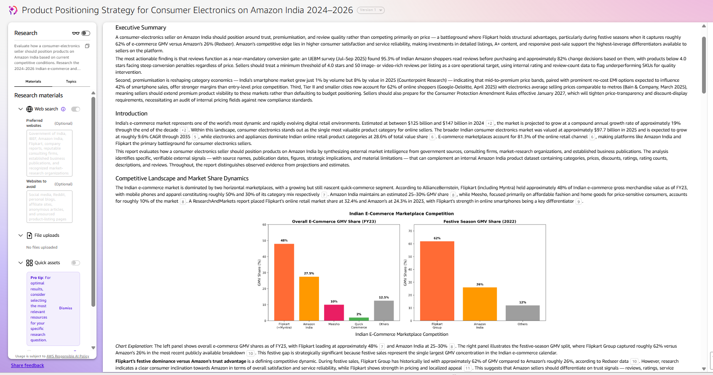
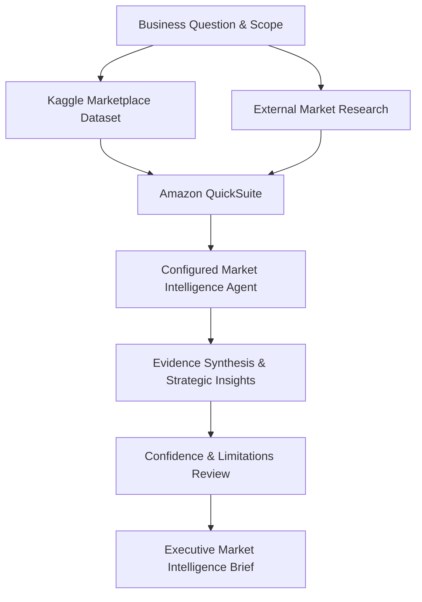
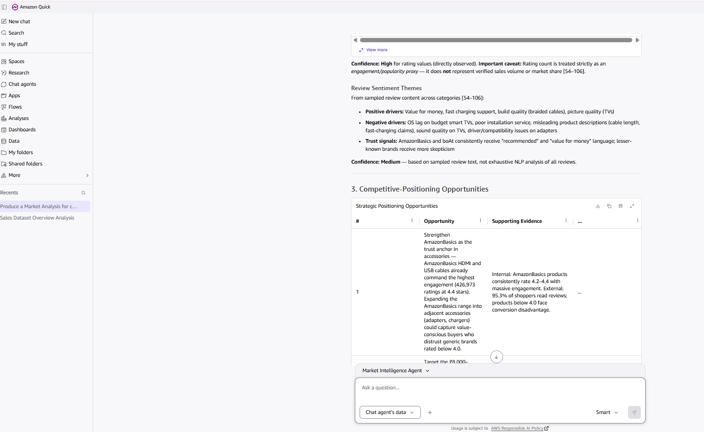

# AI-Powered Market Intelligence Agent

## Amazon India Consumer Electronics Competitive Positioning

This case study demonstrates a no-code, AI-assisted market-intelligence workflow designed in Amazon QuickSuite. The workflow combines product-level marketplace data with external research, converts the evidence into decision-relevant insights, and explicitly evaluates confidence, limitations, and risk.

## Business question

How should a consumer-electronics seller position its products on Amazon India based on category conditions, price and discount patterns, customer ratings, review activity, and current competitive signals?

## Scope

Included:

- Consumer-electronics products represented in the Kaggle Amazon Sales Dataset
- Product prices, discounts, ratings, rating counts, categories, and review signals
- External evidence concerning Indian e-commerce and consumer-electronics conditions
- Competitive positioning, customer expectations, and category opportunities

Excluded:

- Verified unit sales, revenue, profitability, inventory, and market share
- Individual customer demographics
- Causal claims that discounts create sales
- Long-term forecasting unsupported by the available snapshot data

## Workflow

1. Defined the leadership decision, research objective, scope, and non-goals.
2. Uploaded the Kaggle dataset as the internal knowledge source in Amazon QuickSuite.
3. Used Quick Research to collect external market and competitor signals.
4. Directed a custom Market Intelligence Agent to synthesize internal and external evidence.
5. Produced three-to-five decision-relevant insights with strategic implications.
6. Evaluated each insight for source quality, consistency, timeliness, confidence, and limitations.
7. Organized the dataset, research, analysis, evidence, and final brief in a QuickSuite Space.

### Solution architecture

The workflow combines marketplace data and external research in Amazon QuickSuite, using a configured AI agent to develop and evaluate evidence-based positioning recommendations.

## Key findings

- Ratings and review depth provide a stronger differentiation signal than discounting alone in commoditized accessory categories.
- Catalog quality and specification accuracy are material positioning risks because inconsistent listing data can weaken buyer confidence and analytical reliability.
- Premium product positioning requires value proof through service, financing, warranty, installation, or ecosystem benefits rather than price alone.
- Several conclusions remain directional because the dataset is a static marketplace snapshot and does not contain verified sales volume or competitor market share.

## Business Applications

The findings provide a foundation for several potential business decisions:

- **Product positioning:** Differentiate commoditized products through customer trust, verified specifications, and product quality rather than discounting alone.
- **Pricing strategy:** Evaluate discounting alongside customer ratings, competitive conditions, and perceived value before adjusting pricing.
- **Catalog optimization:** Prioritize improvements to product descriptions, specifications, and listing consistency to strengthen customer confidence.
- **Premium differentiation:** Assess warranty coverage, financing, installation, and service offerings as potential sources of competitive advantage.

**Decision-making value:** The workflow demonstrates how AI-assisted market intelligence can organize fragmented information into actionable recommendations while maintaining transparency around evidence quality and uncertainty.

*These are strategic applications derived from the analysis, not implemented interventions or verified financial outcomes.*

## Reliability controls

- Evidence was separated into internal dataset signals and external research signals.
- Rating count was treated as an engagement or popularity proxy, not as sales.
- Source quality, cross-source consistency, signal timeliness, and confidence were assessed separately for each major insight.
- Explicit non-conclusions prevent correlation from being presented as causation.

## Project Evidence

The following artifacts document the AI-assisted research workflow, analytical findings, and final recommendations.

| Artifact | Description |
|---|---|
| [Research Output and Visual](05_Quick_Research_Output_and_Visual.png) | Example of Quick Research output and supporting evidence |
| [Positioning Opportunities and Confidence Assessment](08_Positioning_Opportunities_and_Confidence.png) | Strategic opportunities and confidence evaluation |
| [Executive Market Intelligence Brief](Amazon_India_Market_Intelligence_Final_Brief.pdf) | Final synthesis of market findings, limitations, and recommendations |

These artifacts demonstrate the configured workflow and analytical deliverables. The project was completed in Amazon QuickSuite; it is not presented as an independently developed AI model.

## Deliverables

- [Leadership-ready market intelligence brief](Amazon_India_Market_Intelligence_Final_Brief.pdf)
- Selected workflow evidence included in the repository
- [Original Kaggle dataset page](https://www.kaggle.com/datasets/karkavelrajaj/amazon-sales-dataset)

## Tools and methods

Amazon QuickSuite, Quick Research, custom AI agent configuration, Kaggle data, competitive analysis, evidence synthesis, confidence assessment, executive communication

## Skills demonstrated

Market intelligence · Competitive analysis · Generative AI · Research design · Data interpretation · Risk assessment · Executive communication

## Attribution

Completed by **Yayson Valencia** as part of the Udacity Future AWS Agentic AI Business Professional program. Amazon QuickSuite supported research and synthesis. The author defined the decision framework, configured the workflow, evaluated the evidence, reviewed the AI-generated outputs, documented limitations, and prepared the final recommendations.

## Data note

The raw Kaggle dataset is not redistributed in this repository. The linked source remains the authoritative location. No private QuickSuite access link, account information, or course-submission material is included.
